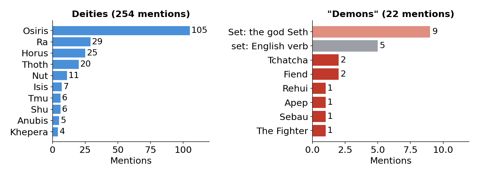
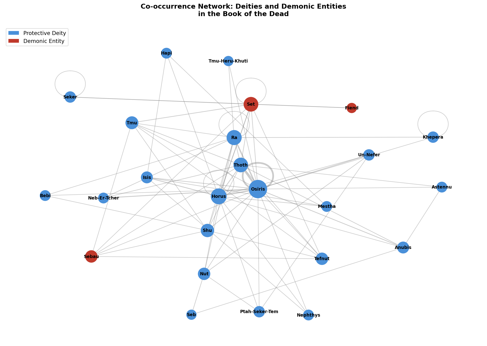
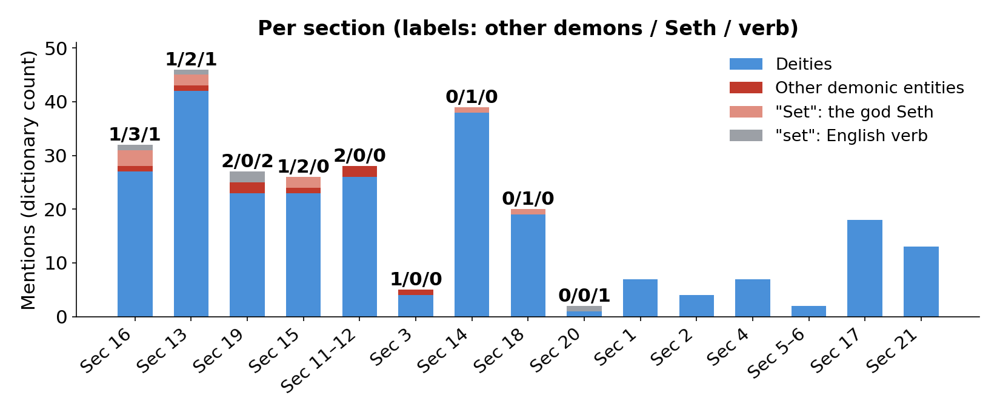

# Demonic and Protective Entities in the Book of the Dead
### A Computational Demonology Using NLP and Named Entity Recognition

**Author:** Juhi Jadhav  
**Field:** Digital Humanities / Computational Egyptology  
**Status:** Ongoing Research Project

---

## Overview

An exploratory study of supernatural agents, sacred places, and ritual objects in sixteen sections of E. A. Wallis Budge's 1895 English translation of the Papyrus of Ani. Entities were annotated with a hand-built dictionary, which then trained a small spaCy model and a co-occurrence network.

The research question was:

> *"How are demonic and protective supernatural agents distributed across Book of the Dead spells, and what can computational patterns reveal about their roles in ancient Egyptian funerary belief?"*

The most useful result came from checking the counts against the text itself.

---

## What checking the counts showed

**1. Most of the "demons" are the word "Set".** The dictionary found 257 deity and 23 demon mentions. Fifteen of the 23 are the string "Set": ten times the god Seth, whom the taxonomy had filed as a demon, and five times the English verb ("stars that never set", "Set up columns"). Every hit is listed in [`outputs/count_checks.md`](outputs/count_checks.md).

**2. Many "Osiris" mentions are the deceased.** Osiris has 106 deity mentions, but in Budge's translation the deceased is also called Osiris ("Osiris, the scribe Ani"). At least 28 of the 106 refer to Ani, not the god.

**3. The section numbers are Budge's, not spell numbers.** The files here are sections of the translation. File 13, for example, is BD 18 (the Thoth litany) and file 19 is a hymn to Ra, so the per-file counts cannot be read as a distribution across Book of the Dead chapters.

**4. The co-occurrence network is too thin to interpret.** It has 37 nodes and 81 edges; its strongest deity-demon pair, Tmu and Set, rests on three sentences.

**The lesson.** A count taken from a translation measures the translator's vocabulary, and a category imposed on Egyptian beings (here, Seth as a "demon") is an argument rather than a label. That is why the follow-up work, [Egyptian Transliteration NER](https://github.com/Juhij2/egyptian-transliteration-ner), reads Egyptian transliteration directly and takes its entity types from the corpus's own expert annotation.

---

## Visualizations

### Entity Frequency: Deities vs Demonic Agents


### Co-occurrence Network


### Chapter-level Distribution


---

## Methodology

### Entity Taxonomy
A domain-specific entity taxonomy was designed with six categories:

| Category | Description | Examples |
|---|---|---|
| `DEITY` | Protective gods and goddesses | Osiris, Ra, Thoth, Horus, Isis |
| `DEMON` | Demonic and threatening agents | Apep, Set, Sebau, Tchatcha |
| `LOCATION` | Sacred ritual locations | Duat, Amenta, Annu, Hall of Two Truths |
| `OBJECT` | Sacred ritual objects | utchat, urerit crown, sektet boat |
| `RITUAL` | Ceremonial actions | weighing of the heart, judgment |
| `ROLE` | Human and ritual roles | the deceased, the scribe, the doorkeeper |

### Pipeline

```
Raw Text Files (16 sections)
        ↓
Sentence Tokenization (NLTK)
        ↓
Text Cleaning (regex preprocessing)
        ↓
Dictionary Annotation (104 hand-listed entities)
        ↓
Small spaCy Model Trained on the Dictionary Labels
        ↓
Entity Analysis & Visualization (matplotlib, networkx)
```

### Corpus
- 16 sections of the *Book of the Dead*, from E. A. Wallis Budge's 1895 translation of the Papyrus of Ani (not Book of the Dead spell numbers)
- 407 cleaned sentences
- 527 entity annotations
- 104 unique entities across 6 categories

### Limitations
- All analysis is performed on English translations, not original ancient Egyptian
- Counts come from dictionary matching, so they inherit every ambiguity of the English (the verb "set", the deceased called "Osiris")
- The taxonomy files Seth as a demon, which Egyptological scholarship does not support; Egyptian has no word that separates "demon" from "deity", and scholars classify beings by function
- The spaCy model was trained and inspected on the same dictionary labels, with no held-out evaluation
- 16 sections is a small corpus

---

## How to Run

### Requirements
```bash
pip install nltk spacy networkx matplotlib
python -m spacy download en_core_web_sm
```

### Run the Notebook
```bash
jupyter notebook egypt_ner.ipynb
```

Run all cells in order. The notebook is fully commented and self-contained.

---

## Relation to Ongoing Research

This project is part of a larger research portfolio combining NLP and Egyptology, which includes:

- **Project 1:** Computational Analysis of Themes and Genre in Ancient Egyptian Texts (TF-IDF, LDA, sentence embeddings, genre classification)
- **Project 2:** Semantic Search for Historical Texts (vector-based retrieval using sentence embeddings)
- **Project 3 (this project):** Demonic and Protective Entity Analysis using domain-specific NER

Together these projects form a coherent computational research arc analyzing the *Book of the Dead* from three angles: thematic structure, semantic meaning, and entity population.

---

## Future Work

- Expand corpus to the full Papyrus of Ani and additional Book of the Dead manuscripts
- Apply methods directly to transliterated ancient Egyptian text using the Thesaurus Linguae Aegyptiae
- Extend entity taxonomy to include dynasty and provenance metadata
- Cross-genre comparison with Egyptian mythic narratives

---

## Contact

**Juhi Jadhav**  
[LinkedIn](https://www.linkedin.com/in/juhijadhav)
